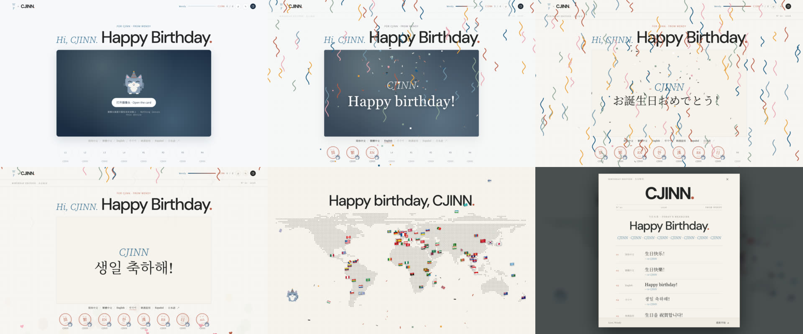

# gesture-birthday-card

An agent skill for making a birthday card web page you play with your fingertips. Touch a fingertip to your thumb: the card calls a nickname, then says happy birthday in another language. Each finger moves the card from your style (your persona) to theirs (their website); the last one plays a finale with a world map and a birthday newspaper page. No camera? Click, or press 1–8.

一个 agent skill：做一张用指尖玩的生日贺卡网页。拇指碰一下某根手指，卡片喊出一个昵称，再用一种语言说生日快乐。每碰一根，卡片就从你的风格（persona）走向对方的风格（他的网站）；最后一根放大结局：世界地图和一页生日特刊。没有摄像头也能点按或按 1–8。



▶ **[Try a live card](https://wenyufan.vercel.app/playground/birthday-card/index.html)** (webcam, or press 1–8 / 摄像头，或按 1–8)

## Install

Works with any agent that reads `SKILL.md` skills (Claude Code, Codex and others). Put this folder where your agent loads skills, for example with Claude Code:

```
git clone https://github.com/fanwy16/gesture-birthday-card ~/.claude/skills/gesture-birthday-card
```

Claude app: download the repo as a ZIP (Code → Download ZIP), then Settings → Capabilities → Skills → upload it.

Then ask: "Make a gesture birthday card for my friend". The example card (Wendy → CJINN) runs as is: `cd template && python3 -m http.server 4321`.

Needs a webcam and Chrome. On a Mac, Node is used to record the voices.

## Credits

- Adapted from [TapTalk](https://github.com/cocozhuk/Taptalk---talk-through-your-fingers-) (fingertip contact detection, `template/contact-tracker.mjs`).
- The example's recipient style follows [cjinn.org](https://cjinn.org/).
- Hand model: [MediaPipe](https://github.com/google-ai-edge/mediapipe), Apache-2.0. Fonts: Open Sans, Source Serif 4, IBM Plex Mono, SIL OFL 1.1.

## License

MIT.
